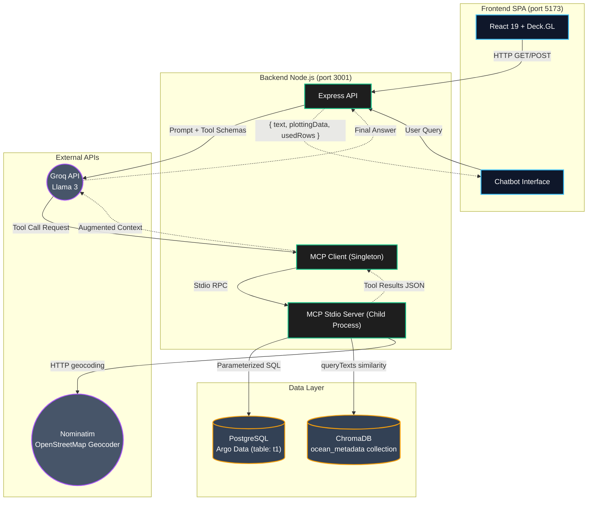
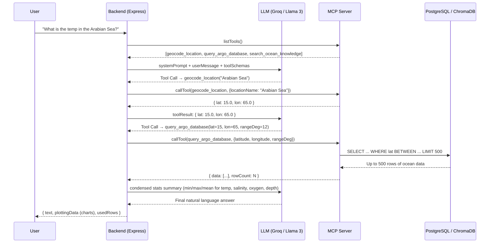

# 🌊 FloatChat (SIH-40)
**AI-Powered Conversational Interface for ARGO Ocean Data Discovery and Visualization**

**FloatChat** is a comprehensive full-stack application built for the **Smart India Hackathon (SIH)**. It democratizes access to complex global oceanographic data from Argo floats — letting anyone query, visualize, and understand ocean data through natural language, with zero SQL or domain expertise required.

It features a stunning **"Deep Ocean / Cyber-Nautical"** aesthetic, interactive 3D WebGL maps, depth profiles, real-time charts, and an integrated **Retrieval-Augmented Generation (RAG)** pipeline powered by the **Model Context Protocol (MCP)**.

---

## ✨ Key Features

### 1. 🤖 AI Chatbot with Agentic RAG Pipeline
- Built on **Llama 3 LLM** (via Groq's ultra-low-latency LPU inference).
- The LLM autonomously orchestrates up to **10 tool-calling iterations** per query — geocoding, database lookup, and knowledge retrieval happen without any user intervention.
- **Semantic Search:** Uses a **ChromaDB vector database** to retrieve contextual oceanographic knowledge (e.g., *"What is a BGC float?"*).
- **Keyword fallback RAG:** A weighted keyword scorer against a local JSON knowledge base serves as a secondary retrieval strategy when ChromaDB is unavailable.

### 2. ⚙️ Autonomous Tool Calling via Model Context Protocol (MCP)
- The backend runs an **MCP Server** over **stdio transport** (child process IPC), exposing 3 standard tools:
  - `query_argo_database` — Bounding-box SQL query against PostgreSQL (up to **500 rows**)
  - `search_ocean_knowledge` — Semantic ChromaDB vector search (top **2 results**)
  - `geocode_location` — Nominatim OpenStreetMap geocoder for human-readable location names
- The LLM dynamically discovers tools at runtime via `listTools()` — no hardcoded routing.

### 3. 🗺️ Interactive 3D Ocean Maps
- GPU-accelerated, edge-to-edge map built with **Deck.GL** (WebGL) and **React Map GL / MapLibre GL**.
- Renders **thousands of Argo float locations globally** in real time without frame drops.
- Includes a **React Globe** view for planetary-scale visualization.

### 4. 📊 Data Dashboards & Depth Profiles
- Interactive charts built with **Recharts** and **D3.js**:
  - Temperature vs. Depth profiles
  - Salinity, Oxygen, Pressure, Nitrate time-series
  - Regional metric comparisons
- **Data Export:** Download AI-extracted data as CSV for scientific analysis.
- **Comparison Modal:** Side-by-side regional ocean metric comparisons.

### 5. 🗄️ Robust NetCDF Data Ingestion Pipeline
- Parses raw **NetCDF (`.nc`)** files from the international Argo program using `netcdfjs`.
- Handles both **JULD** (days since 1950-01-01 UTC) and **epoch** time formats.
- Filters Argo sentinel/fill values (e.g., `99999`) during ingestion via range-clamped coercion.
- Supports all BGC variables: `TEMP`, `PSAL`, `DOXY`, `NITRATE`, `PRES`, `DEPTH`.
- Handles dual longitude conventions: **0–360°** (Argo storage) ↔ **−180–180°** (web maps).

### 6. 🎨 Cyber-Nautical UI
- Glassmorphic dark-mode interface styled like a modern **submarine HUD**.
- Built with **React 19**, **Tailwind CSS**, and custom CSS variables for the design system.
- Smooth animations via **Framer Motion** and **GSAP**.
- Scrollytelling intro powered by `ScrollyIntro` component.

---

## 🏗️ System Architecture

The application uses a modern **Agentic Architecture** with clean separation between: frontend SPA, API orchestrator, MCP tool server, and data layer.



---

## 🔄 Agentic RAG Request Flow

When a user types a question, the system dynamically routes through up to 10 tool-calling iterations before generating a final answer.



---

## 🛠️ Tech Stack

### Frontend (`frontend_sid/`)
| Category | Technology |
|----------|-----------|
| Framework | React 19 + Vite 7 |
| Styling | Tailwind CSS v4 + Custom CSS variables |
| 3D Maps | Deck.GL v9, React Map GL, MapLibre GL, React Globe GL |
| Charts | Recharts, D3.js |
| Animation | Framer Motion, GSAP |
| Routing | React Router DOM v7 |
| Icons | Lucide React |
| Export | jsPDF, html2canvas |

### Backend (`backend_sid/`)
| Category | Technology |
|----------|-----------|
| Server | Node.js + Express 5 |
| AI Agent Protocol | `@modelcontextprotocol/sdk` v1.30 |
| LLM Provider | Groq API (Llama 3, temperature: 0.1) |
| Database | PostgreSQL + `pg` driver |
| Vector Database | ChromaDB v3.5 (Docker) |
| NetCDF Parser | `netcdfjs` v3 |
| Environment | `dotenv` |

### MCP Server (`mcp-server/`)
| Category | Technology |
|----------|-----------|
| Protocol | MCP over Stdio transport |
| Schema Validation | Zod |
| Vector Search | pgvector cosine similarity (`<=>` operator) |
| Embeddings | Custom embedding via `embeddings.js` |

---

## 🗃️ Database Schema

**Table: `t1`** — Main Argo float measurements

| Column | Type | Description |
|--------|------|-------------|
| `id` | `SERIAL PRIMARY KEY` | Auto-increment row ID |
| `temperature` | `DOUBLE PRECISION` | Water temp in °C (valid: −5 to 50) |
| `latitude` | `DOUBLE PRECISION` | Float latitude |
| `longitude` | `DOUBLE PRECISION` | Float longitude (stored as 0–360°) |
| `pressure` | `DOUBLE PRECISION` | Pressure in dbar (valid: −10 to 12,000) |
| `salinity` | `DOUBLE PRECISION` | Salinity in PSU (valid: 0–60) |
| `oxygen` | `DOUBLE PRECISION` | Dissolved oxygen in µmol/kg (valid: 0–1000) |
| `nitrate` | `DOUBLE PRECISION` | Nitrate in µmol/kg |
| `depth` | `DOUBLE PRECISION` | Depth in meters (valid: −10 to 12,000) |
| `time_ts` | `TIMESTAMPTZ` | Measurement timestamp (from JULD or epoch) |
| `created_at` | `TIMESTAMPTZ` | Ingestion timestamp |

> **Note on JULD:** Argo uses Julian Day (days since 1950-01-01 UTC). The ingestion pipeline converts JULD → UTC timestamp automatically.

> **Note on longitude:** Argo data uses 0–360° convention. All queries handle both representations via dual-range `OR` clauses.

---

## 🌊 Supported Ocean Regions (Named Lookup)

The backend has a hardcoded fast-lookup table for **20+ named ocean regions** (e.g., `"Arabian Sea"`, `"Bay of Bengal"`, `"Mediterranean Sea"`), resolving them to bounding boxes before hitting the geocoder — reducing latency for common queries.

---

## 🚀 Getting Started

### Prerequisites
- **Node.js** v18+
- **PostgreSQL** (running locally, database: `argo_data`)
- **Docker** (for ChromaDB)
- **Groq API Key** (free tier available at [console.groq.com](https://console.groq.com))

---

### Step 1 — Vector Database (ChromaDB)

Start ChromaDB via Docker:
```bash
docker run -p 8000:8000 chromadb/chroma
```

Seed the ocean knowledge base:
```bash
cd backend_sid
node setup_vector_db.js
```

This stores **6 oceanographic reference documents** in the `ocean_metadata` collection.

---

### Step 2 — Backend (PostgreSQL + Node.js + MCP)

```bash
cd backend_sid
npm install
```

Create a `.env` file:
```env
GROQ_API_KEY=your_groq_api_key_here
DB_USER=postgres
DB_HOST=localhost
DB_NAME=argo_data
DB_PASSWORD=your_password
DB_PORT=5432
PORT=3001
```

Initialize the database table:
```bash
npm run create:table
```

Ingest Argo NetCDF files (place `.nc` files inside `backend_sid/Argo data/`):
```bash
npm run insert:argo
```

Start the backend server (also spawns the MCP child process):
```bash
node server.js
```

The API is now live at **`http://localhost:3001`**.

---

### Step 3 — Frontend

```bash
cd frontend_sid
npm install
npm run dev
```

Open **`http://localhost:5173`** to explore FloatChat!

---

## 📡 API Endpoints

| Method | Endpoint | Description |
|--------|----------|-------------|
| `POST` | `/ai/chat` | Main agentic chat endpoint — RAG + MCP tool calling |
| `GET` | `/everything` | All float records (lat, lon, depth, time) |
| `GET` | `/latlong?lat=&lon=` | Records at an exact coordinate (limit 50) |
| `GET` | `/temperature` | All temperature readings with coordinates |
| `GET` | `/salinity` | All salinity readings |
| `GET` | `/oxygen` | All dissolved oxygen readings |
| `GET` | `/pressure` | All pressure readings |
| `GET` | `/nitrate` | All nitrate readings |
| `GET` | `/depth` | All depth readings |
| `GET` | `/profiles?lat=&lon=&rangeDeg=` | Depth profiles for a spatial region |
| `GET` | `/time` | Timeseries metadata (lat, lon, timestamp) |
| `GET` | `/api/obis/species` | Marine biodiversity data from OBIS API |

---

## 🔐 Environment Variables

| Variable | Required | Description |
|----------|----------|-------------|
| `GROQ_API_KEY` | ✅ | Groq LLM API key |
| `DB_USER` | ✅ | PostgreSQL username |
| `DB_HOST` | ✅ | PostgreSQL host (default: `localhost`) |
| `DB_NAME` | ✅ | PostgreSQL database name |
| `DB_PASSWORD` | ✅ | PostgreSQL password |
| `DB_PORT` | ✅ | PostgreSQL port (default: `5432`) |
| `PORT` | ⬜ | Backend server port (default: `3001`) |

---

## 🧠 How the RAG Pipeline Works

1. **User sends a message** to `/ai/chat`
2. **MCP Client** (singleton, stdio transport) fetches available tool schemas from the MCP Server
3. **Groq LLM** receives: system prompt + conversation history + tool schemas
4. LLM decides whether to call a tool or respond directly
5. If a **tool call** is returned:
   - `geocode_location` → hits Nominatim OpenStreetMap API
   - `query_argo_database` → executes parameterized SQL with bounding box; returns up to 500 rows with condensed stats
   - `search_ocean_knowledge` → queries ChromaDB by semantic similarity (top 2 docs)
6. Tool result appended to message history → sent back to LLM (loop, max **10 iterations**)
7. LLM generates final answer (capped at **120 words**, 3–4 bullets)
8. Backend returns `{ text, plottingData, usedRows }` → frontend renders text + interactive charts

---

## ⚠️ Known Limitations & Future Improvements

- **No authentication or rate limiting** — `/ai/chat` is open. Future: JWT auth + `express-rate-limit`.
- **`/everything` has no pagination** — suitable only for small local datasets. Future: `LIMIT`/`OFFSET` pagination.
- **No spatial index on lat/lon** — bounding box queries scan the full table. Future: PostGIS `GiST` index on `(latitude, longitude)` for 10–50× speedup.
- **MCP over stdio only** — can't horizontally scale MCP independently. Future: HTTP/SSE transport.
- **ChromaDB seeded with only 6 documents** — expand with full Argo program documentation.
- **No streaming** — full response waits for all tool calls to finish. Future: Server-Sent Events for real-time streaming.

---

## 👥 Team

Built for the **Smart India Hackathon (SIH-40)** — Problem Statement on Ocean Data Democratization.

---

*🌊 FloatChat — Making the ocean's data speak in plain language.*
